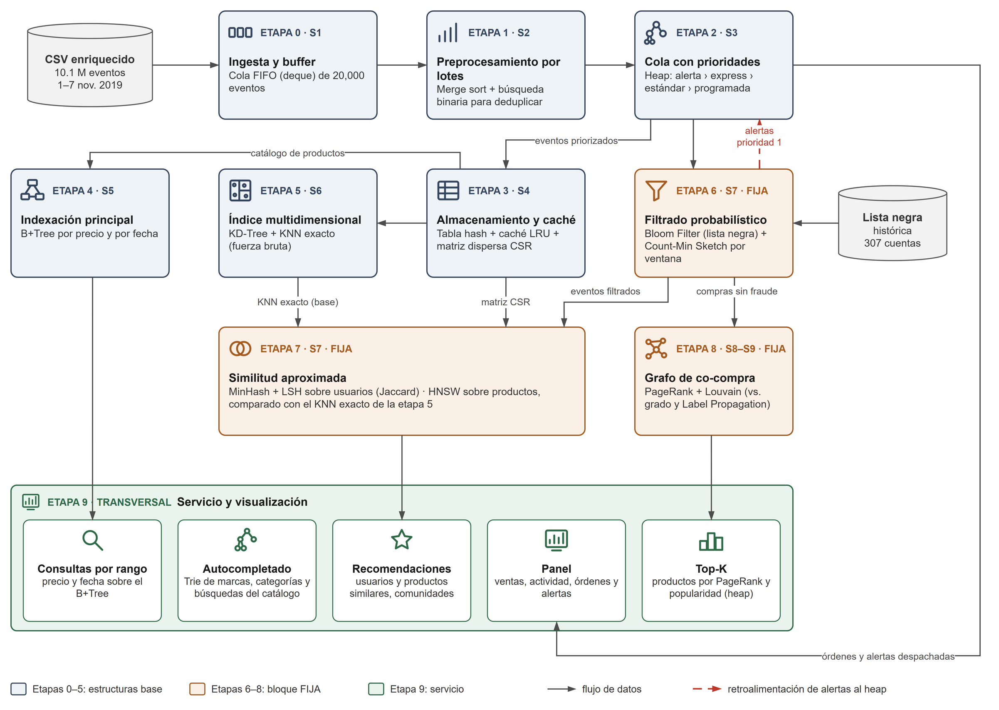

# Guía de exposición y contexto del proyecto

Proyecto final de **Estructuras de Datos y Algoritmos (2026-2)**, UTEC. Docente: Heider Sánchez. Opción B: comercio electrónico.

Este documento reúne todo lo que se decidió, corrigió y explicó mientras se construía el pipeline: de dónde salen los datos, qué hace cada etapa y por qué, qué se cambió respecto a la primera versión del equipo, las cifras finales y las preguntas que pueden hacer en la sustentación. Todas las cifras salen de la ejecución final de `Proyecto_Ecommerce.ipynb` (29 de octubre de 2026) sobre los 10,099,764 eventos.

## Contenido

1. [El proyecto en un minuto](#1-el-proyecto-en-un-minuto)
2. [Cómo se evalúa la exposición](#2-cómo-se-evalúa-la-exposición)
3. [Los datos](#3-los-datos)
4. [Arquitectura del pipeline](#4-arquitectura-del-pipeline)
5. [Etapa por etapa](#5-etapa-por-etapa)
6. [Recorrido de un evento por las 10 etapas](#6-recorrido-de-un-evento-por-las-10-etapas)
7. [Experimentación y benchmarks](#7-experimentación-y-benchmarks)
8. [Tiempo de ejecución](#8-tiempo-de-ejecución)
9. [Qué se corrigió respecto a la versión original](#9-qué-se-corrigió-respecto-a-la-versión-original)
10. [Limitaciones que conviene reconocer](#10-limitaciones-que-conviene-reconocer)
11. [Preguntas probables y cómo responderlas](#11-preguntas-probables-y-cómo-responderlas)
12. [Archivos, reproducibilidad y Colab](#12-archivos-reproducibilidad-y-colab)
13. [Pendientes antes de la entrega](#13-pendientes-antes-de-la-entrega)
14. [Cronología del trabajo](#14-cronología-del-trabajo)

---

## 1. El proyecto en un minuto

Una tienda online genera millones de eventos: vistas, carritos y compras. El proyecto construye un **pipeline de 10 etapas** que procesa **10 millones de eventos reales** (dataset REES46, primera semana de noviembre de 2019). Cada etapa usa la estructura de datos más adecuada para su tarea, y **la salida de una etapa alimenta a las siguientes**:

| Etapa | Qué resuelve en la tienda | Estructura |
|---|---|---|
| 0 | Recibir el stream sin perder el orden ni desbordar la memoria | Cola FIFO acotada (`deque`) |
| 1 | Limpiar y quitar duplicados | Ordenación estable (merge sort) + búsqueda binaria |
| 2 | Atender primero lo urgente: alertas, express, estándar, programadas | Heap binario |
| 3 | Consultar un producto al instante | Tabla hash + caché LRU + matriz dispersa CSR |
| 4 | Consultas por rango: precio entre 100 y 300, órdenes de un día | B+Tree |
| 5 | Productos parecidos (exacto) | KD-Tree + KNN exacto como línea base |
| 6 | Detectar cuentas sospechosas con poca memoria | Bloom Filter + Count-Min Sketch por ventana |
| 7 | Usuarios y productos parecidos a gran escala (aproximado) | MinHash + LSH y HNSW |
| 8 | Productos que se compran juntos e influyentes | Grafo de co-compra + PageRank + Louvain |
| 9 | Lo que ve el usuario final | Trie (autocompletado), Top-K con heap, recomendaciones y panel |

**Resultados principales**

- Bloom Filter: 0.98 % de falsos positivos (objetivo 1 %) en **368 bytes**, frente a 41,580 bytes del `set` exacto.
- Count-Min Sketch: 905 cuentas alertadas; **precisión 100 % y recall 93 %** frente a la etiqueta.
- MinHash + LSH: **recall 99.4 %**, 9 veces más rápido que Jaccard exacto.
- HNSW (64 dimensiones): **recall@10 = 1.000**, 7 veces más rápido que la fuerza bruta.
- PageRank: el Top-10 coincide en 9 de 10 con el ranking por grado.
- Louvain frente a Label Propagation: modularidad **0.654 ± 0.002 contra 0.546 ± 0.040**, y más estable (ARI 0.71 contra 0.55).
- Trie: autocompletado **782 veces** más rápido que el recorrido lineal.
- Top-K con heap: **12.8 veces** más rápido que ordenar todo el catálogo.

---

## 2. Cómo se evalúa la exposición

Según `Proyecto EDA - 2026-2.docx`:

| Componente | Peso | Tipo |
|---|---|---|
| Investigación y documentación (informe) | 30 % (6 pts) | Grupal |
| Implementación del sistema | 20 % (4 pts) | Grupal |
| Experimentación y análisis | 20 % (4 pts) | Grupal |
| **Presentación y sustentación** | **30 % (6 pts)** | **Individual** |

**Formato:** 15 minutos de exposición más 10 de preguntas, 10–15 diapositivas y una **demo de 3–4 minutos**.

**Nota individual (6 pts):**

| Criterio | Pts | Qué miran |
|---|---|---|
| Exposición de su parte | 2 | Claridad, manejo del tiempo, diapositivas y demo de la etapa o familia que le tocó |
| Sustentación oral | 3 | 2–3 preguntas sobre **cualquier** parte del proyecto, no solo la propia. Justificar decisiones de diseño, elección de estructuras y significado de los resultados |
| Contribución verificable | 1 | Historial de commits, responsabilidad declarada en el README y coherencia con lo que sustenta |

**Reglas que hay que tener presentes**

- Cada integrante es responsable principal de **al menos dos etapas o de una familia** del bloque avanzado, y la expone.
- **Si un integrante no puede explicar el algoritmo o el resultado que él mismo presenta, obtiene 0 en la sustentación.**
- Faltar sin justificación significa 0 en los 6 puntos.

**La demo debe mostrar**, según el enunciado: un evento que atraviesa las diez etapas y produce una salida observable, prioridades, filtrado probabilístico, similitud frente a un método exacto, análisis del grafo y servicio al usuario final. La celda 9.6 del notebook hace exactamente eso (ver la [sección 6](#6-recorrido-de-un-evento-por-las-10-etapas)).

### Reparto acordado

Según `Presentacion_Ecommerce.pptx` (13 diapositivas, 15 minutos, demo de 3:30) y la tabla de responsables del README:

| Integrante | Etapas | Diapositivas que expone |
|---|---|---|
| Noelia Varillas | 0, 1 y 6 | 2 (caso del evento 712), 4 (con Sergio), 6 (Bloom y CMS), 10 (con Andrés) |
| Sergio Mestas | 2 y 9 | 1 (portada), 3 (arquitectura), 4 (con Noelia), 11 (servicio), 12 (coordina la demo), 13 (limitaciones) |
| **Sebastián Julon** | **3, 4 y 8** | **5 (con Andrés) y 9 (grafo de co-compra); en la demo explica PageRank y la comunidad del producto** |
| Andrés Bravo | 5 y 7 | 5 (con Sebastián), 7 (MinHash + LSH), 8 (HNSW), 10 (con Noelia) |

Toda la presentación sigue un mismo caso: **el evento 712**, la compra del producto 1004856 (smartphone Samsung) por la cuenta 562958505.

### Tu parte (Sebastián): etapas 3, 4 y 8

**Diapositiva 5 · Consultas e índices de productos (50 s, 03:20–04:10, con Andrés).** Guion de la presentación:

> "Guardamos los productos en una tabla hash para buscarlos por identificador. La caché LRU conserva consultas recientes y el índice ordenado permite buscar rangos de precio y fecha. Para las interacciones usamos una matriz dispersa de unos 71 MiB. El KD-Tree busca vecinos en cuatro atributos normalizados y sirve como referencia exacta para la búsqueda aproximada."

Las tres primeras frases son tuyas (etapas 3 y 4); la del KD-Tree es de Andrés (etapa 5). Cifras que conviene tener en la cabeza: 133,905 productos, 1,104,386 usuarios, 5.8 millones de interacciones, 71 MB contra 1,102 GB densa, LRU de 1,000 con 49.4 % de aciertos, rango 100–300 con 34,581 productos en 4.95 ms contra 31.10 ms.

**Diapositiva 9 · Co-compra: PageRank y comunidades (60 s, 07:05–08:05).** Guion:

> "Cada nodo representa un producto. Unimos dos productos cuando aparecen en la misma orden, y el peso cuenta las órdenes que comparten. PageRank calcula importancia estructural; Louvain y Label Propagation agrupan productos. Louvain obtiene modularidad de 0,6538 frente a 0,5459 y mayor estabilidad entre semillas. La comparación usa 5.199 productos no aislados, distribuidos en 893 componentes. El 71 % del grafo completo queda aislado."

**En la demo (diapositiva 12):** explicas que el producto 1004856 ocupa el **puesto 1 de 17,933 en PageRank** y pertenece a una **comunidad Louvain de 537 productos** (identificador 544).

**Lo que más probablemente te pregunten de tu parte** (las respuestas están en la [sección 5](#5-etapa-por-etapa) y la [sección 11](#11-preguntas-probables-y-cómo-responderlas)):

- ¿Cómo sabe la tabla hash a qué casilla ir? ¿Qué pasa con las colisiones?
- ¿Para qué sirve la LRU si la tabla hash ya es O(1)?
- ¿Cómo funciona CSR (`data`, `indices`, `indptr`) y por qué ocupa tan poco?
- ¿Por qué un B+Tree y no la tabla hash para rangos? ¿Qué lo hace bueno para disco? (Ojo: `OOBTree` vive en memoria; el índice no se persiste.)
- ¿Qué mide PageRank y qué aporta si coincide 9 de 10 con el grado? (Spearman 0.385 en el resto.)
- ¿Cómo funciona Louvain? ¿Qué es la modularidad? ¿Qué es el ARI y por qué Louvain es más estable?
- ¿Por qué el 71 % de los productos queda aislado? (Solo 7,472 de 122,225 órdenes tienen 2 o más productos.)

Recuerda que la sustentación puede preguntar **cualquier** etapa, no solo las tuyas.

---

## 3. Los datos

### 3.1 Por qué este dataset

Se compararon dos archivos:

| Criterio | `2019-Nov.csv.zip` (elegido) | `archive.zip` (descartado) |
|---|---|---|
| Qué es | Un evento por fila con fecha y hora: un stream real | Una fila por usuario con promedios (modelo de churn) |
| Volumen | ~67.5 M de eventos en noviembre; sobran para 10 M | 112 K filas |
| `product_id`, categoría, marca, precio | Sí | No |
| Compras agrupables por sesión (co-compra) | Sí, con `user_session` | No |

Es el dataset que recomienda el propio enunciado: *eCommerce behavior data from multi category store* (REES46, Kaggle).

### 3.2 Qué se tomó

- Las **primeras 10,000,000 filas** de `2019-Nov.csv`, que cubren del 1 al 7 de noviembre de 2019 en orden temporal real. El enunciado pide 10 M como escala máxima.
- El resultado es `2019-Nov-enriquecido.csv`: 10,099,764 filas (10 M originales + 99,764 duplicados inyectados) y 18 columnas.

**¿Por qué el archivo nuevo pesa menos que el original si tiene más columnas?** Porque tiene muchas menos filas: 10.1 M contra 67.5 M. Cada fila es un 17 % más grande (155 bytes contra 133), pero eso no compensa. Descomprimido pesa 1.56 GB contra 9 GB; en zip, 0.49 GB contra 2.87 GB.

### 3.3 Columnas: originales, derivadas y de evaluación

**Regla acordada: no inventar datos.** Las columnas nuevas se **derivan de los datos reales** con reglas fijas. Lo único aleatorio (semilla 42) es la suciedad inyectada para que las etapas 0 y 1 tengan trabajo.

| Columna | Origen | Regla | Etapa que la usa |
|---|---|---|---|
| `event_time`, `event_type`, `product_id`, `category_id`, `category_code`, `brand`, `price`, `user_id`, `user_session` | Original | — | Todas |
| `event_id` | Generada | Número correlativo por fila | 0, 1, 2 (desempate) |
| `order_id` | Derivada | Una orden por sesión (`user_session`) con compra | 2, 8 |
| `order_type` | Derivada | **scheduled** si el producto es voluminoso (muebles, refrigeradoras, lavadoras…); **standard** si la sesión pasó por el carrito; **express** si fue compra directa sin carrito | 2 |
| `scheduled_time` | Derivada | Fecha de compra + 2 días a las 09:00 (solo programadas) | 2 |
| `stock` | Derivada | Compras reales del producto en el periodo × 1.1, que baja con cada compra | 3 |
| `search_query` | Derivada | Marca o categoría del producto visto (≈ 10 % de las vistas), con prefijos y errores de tipeo como ruido | 9 (Trie) |
| `is_duplicate` | Evaluación | Marca las 99,764 copias inyectadas | Solo para medir la etapa 1 |
| `is_invalid` | Evaluación | Marca las filas corrompidas a propósito | Solo para medir la etapa 1 |
| `is_suspicious` | Evaluación | Cuenta con **≥ 5 compras en una hora o ≥ 10 eventos en un minuto** (conteo exacto) | Solo para medir la etapa 6 |

Archivo aparte: **`blacklist.csv`**, con las **307 cuentas** cuya anomalía apareció el 1 o el 2 de noviembre. Representa el "histórico ya señalado" que se carga en el Bloom Filter. Las otras 666 cuentas sospechosas las tiene que descubrir el Count-Min Sketch por su actividad.

**Lo que se descartó por no tener respaldo en los datos:** tarjeta de pago, dispositivo, IP e intentos de pago fallidos. Una primera versión los generaba al azar y se rehízo. El enunciado dice "medios de pago, dispositivos **o** cuentas", así que trabajar con cuentas (`user_id`, que es real) cumple sin inventar nada.

**Suciedad inyectada (semilla 42):**

- **1 % de duplicados** (99,764): copias reenviadas 1 a 50 filas después, con otro `event_id`.
- **0.1 % de filas corruptas** (el generador reporta 9,805; la etiqueta `is_invalid` marca 9,895 filas en el CSV): precio negativo, `user_id` vacío, fecha inválida o `event_type` mal escrito (`VIEW`, `CART`, `PURCHASE`).

**Cifras del dataset:** 126,641 órdenes (62.6 % express, 31.6 % standard, 5.8 % scheduled); 973 cuentas sospechosas (726 por compras por hora y 247 por eventos por minuto); 307 en la lista negra.

### 3.4 Las etiquetas solo sirven para evaluar

Las columnas `is_*` son el **solucionario**: el algoritmo decide sin mirarlas y al final se compara con ellas para medir verdaderos positivos, falsos positivos, falsos negativos, precisión y recall. Si una etapa filtrara con `is_duplicate == 0`, sacaría 100 % siempre, pero no habría detectado nada. **Eso pasaba en la primera versión del notebook y se corrigió.**

**Matiz importante sobre `is_suspicious`:** sale de la misma regla de umbral que aplica el Count-Min Sketch, pero con conteo exacto. Por eso compararlas mide **cuánto error introduce la aproximación**, no si el sistema detecta fraude real. No existe una etiqueta de fraude verdadero en estos datos. Hay que decirlo así si lo preguntan.

---

## 4. Arquitectura del pipeline



### 4.1 Cómo están conectadas las etapas

Es un **pipeline por lotes** (*batch*): las etapas 0 a 2 recorren el stream completo en lotes de 10,000 eventos y dejan su resultado en un archivo que lee la siguiente. Desde la etapa 3 en adelante, cada etapa usa **estructuras en memoria** construidas por las anteriores:

```
CSV ─► Etapa 0 (cola FIFO) ─► Etapa 1 (limpieza) ─► salidas/etapa1_limpia.csv
                                                            │
                                                            ▼
                                         Etapa 2 (heap) ─► salidas/etapa2_priorizada.csv
                                              ▲                     │
                     alertas (prioridad 1)    │                     ▼
                                              │            Etapa 3: tabla_productos, LRU, matriz CSR
                                              │                 │          │            │
                                              │                 ▼          ▼            │
                                              │            Etapa 4      Etapa 5         │
                                              │            (B+Tree)    (KD-Tree)        │
                                              │                                         ▼
                                         Etapa 6 (Bloom + CMS) ─► excluye cuentas ─► Etapa 7 (usa la matriz CSR)
                                                                   alertadas       └► Etapa 8 (compras sin fraude)
                                                                                          │
                                                Etapas 2, 3, 4, 5, 6, 7 y 8 ─────────────►  Etapa 9 (servicio)
```

**Dependencias reales entre etapas** (lo que el enunciado llama "de manera observable"):

- La etapa 1 recibe sus lotes **desde la cola** de la etapa 0, no lee el CSV por su cuenta.
- La etapa 4 indexa por precio la `tabla_productos` de la etapa 3.
- La etapa 5 arma sus vectores desde `tabla_productos` (vistas, carritos, compras), sin volver a leer el CSV.
- La etapa 6 empuja sus alertas al **mismo heap vivo** de la etapa 2 con prioridad 1.
- La etapa 7 usa la **matriz CSR** de la etapa 3 sin las filas de las cuentas alertadas por la etapa 6.
- La etapa 8 recibe solo las compras de cuentas **no alertadas** (`salidas/etapa6_compras_filtradas.csv`).
- La etapa 9 combina todo: heap, hash, B+Tree, KD-Tree, LSH, HNSW, PageRank y comunidades.

### 4.2 Por qué no se usa la misma clave en todas las etapas

Por todas las etapas pasan los mismos eventos, pero cada una **los reorganiza según la pregunta que tiene que responder**:

| Etapa | Clave | Por qué |
|---|---|---|
| 0 | `event_id` | Comprobar que el primero en entrar es el primero en salir |
| 1 | Contenido del evento (fecha, tipo, producto, precio, usuario, sesión) | Una copia reenviada tiene **otro** `event_id`, así que no sirve como clave de duplicado |
| 2 | (prioridad, `event_id`) | Urgencia y, a igual urgencia, orden de llegada |
| 3 | `product_id` | Lo que se consulta en una tienda es el producto |
| 4 | Precio (productos) y fecha (órdenes) | Son los rangos con sentido de negocio |
| 5 | Vector de 4 variables | Cercanía en varias dimensiones |

Al principio las etapas 3 y 4 usaban `event_id` como clave, lo que no respondía ninguna pregunta del negocio ("¿para qué buscar el evento 4,999?"). Se corrigió.

---

## 5. Etapa por etapa

Cada etapa tiene: qué hace, cómo, complejidad, alternativa descartada, resultados, qué se corrigió y una frase para la sustentación.

### Etapa 0 · Ingesta y buffer (cola FIFO)

**Problema.** En una tienda real los eventos llegan en vivo, a veces en ráfagas (Black Friday) más rápido de lo que se pueden limpiar. Se necesita una sala de espera que **respete el orden de llegada** (si alguien agrega al carrito y luego compra, hay que procesarlo en ese orden) y que **no crezca sin límite**.

**Cómo.** El CSV hace de stream. La función `stream_por_buffer` lee el archivo por bloques y **encola cada evento** en una `deque` con capacidad máxima de **20,000 eventos** (2 lotes). Cuando la cola se llena, sale un lote de 10,000 por adelante hacia la etapa 1. Al terminar, se vacía lo que quedó. Esto es *backpressure*: la memoria depende del tamaño del buffer, no del tamaño del stream.

**FIFO y lista enlazada no son cosas distintas.** FIFO es el comportamiento (el primero que entra es el primero que sale). Lista enlazada es una forma de construirla. `collections.deque` es por dentro una lista doblemente enlazada de bloques, escrita en C.

| Operación | `list.pop(0)` | `deque.popleft()` |
|---|---|---|
| Agregar al final | O(1) | O(1) |
| Sacar el primero | **O(n)**: desplaza todos los elementos | **O(1)**: mueve un puntero |

**Resultados.** 1,010 lotes; 10,099,764 eventos pasaron por la cola; **FIFO correcto en todos: `True`**; 52 s. Benchmark (1 M de eventos, buffer de 20 K, 10 repeticiones): deque **111 ms** contra lista **31,794 ms** (≈ 286 veces).

**Se corrigió.** En la versión original la cola solo se probaba con 5 eventos y el stream se leía con `pd.read_csv(chunksize)` sin pasar por ella. Ahora **todo el stream** pasa por la cola. Costo: la etapa 0 pasó de 26 s a 52 s, el precio de que cada evento pase de verdad por la cola.

> **Para la sustentación:** "La etapa 0 recibe el stream evento por evento y lo guarda en una cola FIFO con capacidad máxima. FIFO porque hay que respetar el orden de llegada; `deque` porque sacar el primero cuesta O(1) en vez del O(n) de una lista. El tope de 20,000 eventos mantiene la memoria acotada aunque el stream no tenga fin."

### Etapa 1 · Preprocesamiento por lotes (ordenación + búsqueda binaria)

**Cómo.** Por cada lote de 10,000 que sale de la cola:

1. **Valida** sin mirar etiquetas: fecha parseable, tipo de evento válido, `user_id` presente, precio ≥ 0.
2. **Normaliza** lo recuperable: `"VIEW "` → `view`.
3. Arma una **clave de contenido**: `event_time|event_type|product_id|price|user_id|user_session`.
4. **Ordena** el lote por esa clave con `sort_values(kind="mergesort")` (estable). Así los duplicados quedan uno al lado del otro.
5. **Duplicado dentro del lote:** un evento es duplicado si su clave es igual a la anterior en el lote ordenado (`eq(shift())`).
6. **Duplicado entre lotes:** **búsqueda binaria** (función propia `busqueda_binaria`) de cada clave en las claves ordenadas del lote anterior. Funciona porque las copias llegan como mucho 50 filas después, mucho menos que 10,000.

**Complejidad.** O(B log B) por lote, O(N log B) en total; memoria **O(B)**, constante aunque el stream crezca.

**¿Por qué no un `set`?** Es la pregunta más probable de esta etapa:

| | `set` (hash) | Ordenar + búsqueda binaria |
|---|---|---|
| Tiempo | O(n): lo más rápido | O(n log B) |
| Memoria | **O(n): crece con todo el stream** (1–2 GB para 10 M de claves) | **O(B): constante** |
| Bloque del curso | S4 (corresponde a la etapa 3) | **S2 (corresponde a la etapa 1)** |

Además, el enunciado pide para esta etapa "ordenación eficiente y búsqueda binaria". Si se usara un `set`, esa estructura no aparecería en ningún lugar del pipeline.

**Resultados (10 M eventos, 210 s):**

| | Etiquetados | Detectados | Explicación |
|---|---|---|---|
| Inválidos | 9,895 | **7,356 descartados, 0 falsos** | 2,538 tenían `event_type` mal escrito y se **repararon** en vez de descartarse. 1 tenía precio `-0.0`, que en la práctica es 0 |
| Duplicados | 99,764 | **103,411 eliminados**: 99,704 etiquetados (99.94 %) + 3,707 sin etiqueta | Los 3,707 son **duplicados exactos que ya traía el dataset original**; eliminarlos también es correcto. Los 60 etiquetados que no se marcaron como duplicados eran copias de filas corruptas y ya salieron como inválidos |

Quedan **9,988,997 eventos limpios**. De las filas que siguen siendo válidas no se escapa ningún duplicado.

Benchmark: búsqueda binaria **15 ms** contra lineal **1,755 ms** en 10,000 consultas (≈ 114 veces).

**Se corrigió.**
- La versión original filtraba con `is_invalid == 0` e `is_duplicate == 0`, es decir, **leía la respuesta**. Ahora detecta por sí misma.
- **Bug encontrado al revisar:** se escapaban 42 duplicados. Causa: en un lote con algún `user_id` vacío pandas lee la columna como decimal (`560419616.0`) y en otro sin vacíos como entero (`560419616`), así que el mismo evento generaba claves distintas según el lote. Se arregló convirtiendo `user_id` a entero antes de armar la clave.
- Se usaba `duplicated()`, que internamente usa un hash y no necesita el orden. Se cambió por comparar con el vecino (`eq(shift())`), que es lo que dice el texto: ordenar y comparar vecinos.
- La evaluación ahora cruza los `event_id` uno por uno con las etiquetas, no solo los totales (comparar totales ocultaba el bug).

> **Para la sustentación:** "Ordenamos cada lote por una clave de contenido, así los duplicados quedan juntos y basta comparar cada evento con el anterior; los que caen en el corte entre lotes se encuentran con búsqueda binaria en el lote anterior. Un `set` sería más rápido, pero en un stream sin fin su memoria crece sin límite; ordenar por lote mantiene la memoria en O(B)."

### Etapa 2 · Cola con prioridades (heap)

**Problema.** El enunciado dice: "atender órdenes express, estándar y programadas de acuerdo con su urgencia; las alertas de pago o fraude reciben prioridad". Una FIFO no sirve porque atiende por llegada. Es como una sala de emergencias: un infarto pasa antes que un dolor de cabeza aunque haya llegado después.

**Escala de prioridad (menor número = más urgente):**

| Prioridad | Qué | De dónde sale |
|---|---|---|
| 1 | Alerta de fraude | La genera la **etapa 6** |
| 2 | Orden express | Compra directa sin carrito |
| 3 | Orden estándar | Compra que pasó por el carrito |
| 4 | Orden programada | Producto voluminoso |

A igual prioridad se desempata por `event_id`, es decir, por orden de llegada.

**Cómo.** El heap (`heapq`) **vive durante todo el stream**. En cada lote entran las órdenes nuevas (**cada orden una sola vez**) y se despachan las **100 más urgentes** (`DESPACHOS_POR_LOTE = 100`). Como llegan más órdenes de las que se despachan, el heap acumula espera: justo para eso sirve.

**Un heap** es un árbol binario guardado en un arreglo con una regla: cada padre es más urgente que sus hijos. El más urgente está siempre en la raíz. Insertar: se pone al final y sube. Sacar: se toma la raíz, el último pasa arriba y baja. Ambas son O(log n): con 1 M de órdenes, unos 20 pasos.

| Opción | Insertar | Sacar el más urgente |
|---|---|---|
| Lista sin ordenar | O(1) | O(n) |
| Lista ordenada | O(n) | O(1) |
| **Heap** | **O(log n)** | **O(log n)** |

**Resultados (87 s).** 126,542 órdenes entraron; 99,853 despachadas; 26,689 en espera; tamaño máximo del heap 26,789. Las primeras 10 despachadas son todas express aunque entre ellas llegaron estándar y programadas. El resto sale ordenado por prioridad y llegada: `True`. Benchmark (10,000 push + pop con 26,800 pendientes): heap **7 ms**, lista ordenada **590 ms** (≈ 83 veces), lista sin orden **8,954 ms**.

**Se corrigió.**
- Prioridad 1 usaba `is_suspicious` (la etiqueta). Ahora está reservada para las alertas de la etapa 6.
- El heap se armaba con los **primeros 10,000 eventos** del primer lote (incluidas las vistas); los otros 1,009 lotes nunca entraban. Ahora recibe todas las órdenes del stream.
- Una orden con 3 productos entraba 3 veces (146,973 compras). Ahora entra una vez (126,542 órdenes).
- La celda de validación vaciaba el heap; ahora trabaja sobre una copia para que la etapa 6 pueda usarlo.

> **Para la sustentación:** "El heap siempre deja lo más urgente en la raíz; insertar y extraer cuestan O(log n), frente al O(n) de buscar el mínimo en una lista. Es la etapa que mejor muestra la integración: recibe órdenes de la etapa 1 y alertas de la etapa 6."

### Etapa 3 · Almacenamiento, lookup y caché

Tres estructuras para tres problemas.

**1. Tabla hash (`dict` de Python), clave `product_id`.** Se llena lote por lote: la primera vez que aparece un producto se inserta y después se actualizan sus datos y contadores (vistas, carritos, compras).

La idea clave: **no busca, calcula**. Una función hash convierte el `product_id` en un número de casilla; acceder a una casilla de un arreglo por posición es O(1). Ejemplo con 200,000 casillas: `h(1004856) = 1004856 % 200000 = 4856` → `tabla[4856]`.

- La posición **no se guarda**: se recalcula con la misma fórmula al guardar y al consultar (la función es determinista). Como guardar documentos en cajones con la regla "último dígito del DNI".
- Dentro de la casilla sí se guarda la **clave completa**, para distinguir colisiones (dos claves en la misma casilla, que se encadenan en una lista corta).
- La tabla ocupa según **cuántos productos hay** (134 mil), no según lo grande de sus ids (hasta ~100 millones).
- Si la ocupación pasa de un umbral, la tabla se agranda. Así cada casilla tiene 1–2 elementos en promedio: **O(1) promedio**.
- Equivale a `SELECT ... WHERE product_id = X` con un índice hash (`CREATE INDEX ... USING HASH` en PostgreSQL). Sirve para igualdad exacta, **no para rangos**: para eso está la etapa 4.

**2. Caché LRU (clase propia `CacheLRU` sobre `OrderedDict`), 1,000 productos.** Guarda los productos consultados hace poco y expulsa el menos usado. La primera consulta de un producto va a la tabla hash; la segunda sale de la caché.

Aclaración honesta: en el notebook la tabla hash ya está en memoria y es O(1), así que la caché casi no acelera. Tiene sentido en un sistema real, donde el catálogo vive en una base de datos o en disco. Por eso el enunciado dice "LRU cuando aplique" y lo que se mide es la **tasa de aciertos**, no el tiempo.

**3. Matriz dispersa CSR (`scipy`), usuarios × productos.** Cada celda suma pesos: vista 1, carrito 3, compra 5. La matriz tiene ~148 mil millones de celdas y solo el **0.0039 %** tiene valor. CSR guarda solo esas: `data` (valores), `indices` (columna de cada valor) e `indptr` (dónde empieza cada usuario). Leer la fila de un usuario cuesta O(sus interacciones), no O(catálogo).

**Resultados (37 s).**
- 133,905 productos en la tabla hash. Ejemplo: 1004856 → smartphone Samsung, precio 131.66, stock 542, 86,062 vistas, 6,468 carritos, 5,410 compras.
- Caché LRU: **49.4 % de aciertos** en 100,000 consultas con menos del 1 % del catálogo en caché, porque pocos productos concentran el tráfico.
- Matriz: 1,104,386 usuarios × 133,905 productos, 5,803,455 interacciones. **1,102 GB densa contra 71 MB dispersa** (unas 16,000 veces menos).
- Benchmark: hash **1.2 ms** contra búsqueda binaria 23 ms (≈ 20 veces) y lineal 27,991 ms (≈ 23,700 veces), con 10,000 consultas sobre 133,905 ids.

**Se corrigió.** La clave era `event_id` y la tabla se llenaba con los primeros 10,000 eventos; la LRU tenía capacidad 5 y no medía aciertos; la matriz cubría 10,000 eventos. Ahora todo usa el universo completo y la clave de negocio.

> **Para la sustentación:** "La tabla hash da acceso O(1) por `product_id` porque calcula la casilla en vez de buscarla; la caché LRU simula la capa que evita ir a la base de datos (49 % de aciertos); y la matriz CSR guarda solo las 5.8 millones de interacciones que existen, 71 MB en vez de 1,102 GB."

### Etapa 4 · Indexación principal (B+Tree)

**Problema.** Consultas por **rango**: "productos entre 100 y 300", "órdenes del 1 de noviembre". La tabla hash no sirve: la función hash **desordena** las claves a propósito.

| Consulta | Tabla hash | B+Tree |
|---|---|---|
| Igualdad (`= X`) | **O(1)** | O(log n) |
| Rango (`BETWEEN`) | O(n): revisa todo | **O(log n + k)** |

**Cómo es un B+Tree.** Árbol **ancho y bajo**: cada nodo tiene muchas claves. Los nodos internos solo orientan; las **hojas** tienen todos los datos **ordenados y enlazadas entre sí**. Un rango baja en O(log n) hasta la primera hoja y avanza de hoja en hoja. Al insertar, si una hoja se llena se divide y la clave del medio sube al padre; el árbol crece por arriba y se mantiene balanceado.

¿Por qué "índice de disco"? Con orden 64, 134 mil productos caben en 3 niveles y 10 M en 4–5. En una base de datos cada nodo es una página de disco, así que una búsqueda entre millones cuesta 3–4 lecturas. Por eso PostgreSQL, MySQL y SQL Server lo usan por defecto.

**Cómo en el notebook.** Dos `OOBTree` (librería `BTrees`): `indice_precio` (precio → productos, desde `tabla_productos` de la etapa 3) e `indice_fecha` (segundo → órdenes).

**Resultados (17 s).** 25,300 precios distintos; 113,933 instantes con órdenes. Rango 100–300: **34,581 productos en 4.95 ms contra 31.10 ms** revisando todo, con el mismo resultado (`True`). 19,198 órdenes el 1 de noviembre.

**Se corrigió.** Indexaba `event_id` con un rango "ids 1000–1050" sin uso de negocio. Ahora indexa precio y fecha. Además, una orden con compras en segundos distintos se contaba varias veces (20,425); ahora se cuentan órdenes distintas (19,198). La prueba de "mismo resultado" comparaba solo cantidades; ahora compara los productos exactos.

**Límite a reconocer:** usa la librería `BTrees` y el árbol vive en memoria, no se persiste en disco.

> **Para la sustentación:** "El B+Tree guarda los datos ordenados en hojas enlazadas: baja en O(log n) al inicio del rango y avanza de hoja en hoja. Como cada nodo tiene muchas claves, tiene 3–4 niveles aun con millones de registros, y en disco eso son 3–4 lecturas."

### Etapa 5 · Índice multidimensional y KNN exacto (KD-Tree)

**Problema.** "Productos relacionados": encontrar los K más parecidos considerando **varias variables a la vez**.

**Cómo.** Cada producto de `tabla_productos` es un vector de 4 variables: `log_precio`, `log_vistas`, `log_carritos` y `conversion` (compras ÷ vistas), normalizadas con `StandardScaler` (si no, el precio dominaría la distancia). Se comparan:

- **KNN exacto por fuerza bruta** (`NearestNeighbors(algorithm="brute")`): mide la distancia a todos. O(n·d) por consulta. Es la **línea base** de la etapa 7.
- **KD-Tree** (`sklearn`): divide el espacio alternando ejes por la mediana y **poda** las regiones que no pueden tener un vecino más cercano que el peor de los K actuales. Da **el mismo resultado** revisando una fracción.

**Resultados.**
- Vecinos del 1004856 (Samsung, 131.66): 1004767 (Samsung 240.93), 1005115 (Apple 915.69), 4804056 (audífonos Apple 160.36, buen candidato de venta complementaria), 1004833 y 1004870 (Samsung). KD-Tree y KNN exacto devuelven **exactamente los mismos 5**.
- 100 consultas al azar: **recall@5 por distancia = 1.000**; por ids 0.934. Tiempo: **KD-Tree 2.9 ms contra fuerza bruta 11.8 ms** (≈ 4 veces).

**¿Por qué el recall por ids no da 1.0?** Hay **42,350 productos con el vector idéntico** (poco tráfico, sin carritos ni compras, mismo precio). Si varios empatan a la misma distancia, cada método puede elegir ids distintos y ambos son correctos. Por eso se mide por distancia. Es también un hallazgo: el vector no distingue bien a los productos de poco tráfico.

**¿Por qué KD-Tree y no R-Tree?** R-Tree conviene para **rectángulos o regiones** (mapas, zonas de reparto). Aquí los datos son puntos.

**Límite (maldición de la dimensionalidad):** con más de 15–20 dimensiones la poda casi no descarta nada. Se ve en la etapa 7: con 64 dimensiones el KD-Tree es **35 veces más lento** que la fuerza bruta.

**Se corrigió.** Antes volvía a leer el CSV, usaba solo `price` y `stock` (el stock lo generamos nosotros, así que "parecido en stock" no significa nada) y validaba con 1 consulta.

> **Para la sustentación:** "El KD-Tree divide el espacio alternando ejes y poda regiones que no pueden tener vecinos más cercanos, así que da el mismo resultado que la fuerza bruta revisando pocos productos. Esa respuesta exacta es la línea base para medir el recall de la búsqueda aproximada de la etapa 7."

### Etapa 6 · Filtrado probabilístico [FIJA] (Bloom Filter + Count-Min Sketch)

El enunciado pide reconocer cuentas señaladas, estimar la intensidad de actividad **dentro de una ventana temporal**, definir **clave, ventana y umbral**, y **verificar las alertas antes de bloquear**.

**Bloom Filter (clase propia `BloomFilter`).** Responde "¿esta cuenta está en la lista negra?" con muy poca memoria. Es un arreglo de m bits y k funciones hash. Insertar pone k bits en 1; consultar mira esos k bits: si alguno es 0, **seguro que no está**; si todos son 1, **posiblemente está**.

- **Nunca da falsos negativos**, pero sí falsos positivos. Por eso cada positivo se **verifica contra la lista exacta** antes de alertar.
- Parámetros por fórmula: m = −n·ln p / (ln 2)², k = (m/n)·ln 2. Con n = 307 y p = 1 %: **m = 2,943 bits, k = 7**.
- Hash universal: ((a·x + b) mod (2³¹ − 1)) mod m.

**Count-Min Sketch (clase propia `CountMinSketch`).** Cuenta eventos por cuenta con memoria fija. Es una matriz de d filas × w columnas; cada fila tiene su función hash. Sumar incrementa una celda por fila; estimar toma **el mínimo** de las d celdas.

- **Nunca subestima** (las colisiones solo suman); el error está acotado por ε·N con probabilidad 1 − δ.
- w = ⌈e/ε⌉, d = ⌈ln(1/δ)⌉. Con ε = 0.0005 y δ = 0.01: **w = 5,437, d = 5**, 212 KB por sketch.
- **Clave, ventana y umbral** (los mismos de la regla de `is_suspicious`):
  - (cuenta, minuto): **≥ 10 eventos por minuto**.
  - (cuenta, hora): **≥ 5 compras por hora**.
- **Ventanas fijas** (*tumbling*): el sketch se reinicia al empezar cada ventana.

**Flujo.** Por cada lote: Bloom sobre las cuentas → verificación exacta → alerta. CMS por ventana → si supera el umbral → alerta. Cada alerta entra al **heap de la etapa 2 con prioridad 1**: `(1, event_id, "ALERTA-<cuenta>", motivo)`.

**Resultados (23 s).**
- **905 cuentas alertadas**: 493 por compras por hora, 307 por lista negra y 105 por eventos por minuto.
- Bloom: **0.98 % de falsos positivos** sobre 1,104,079 cuentas fuera de la lista (objetivo 1 %); **368 bytes** contra 41,580 del `set`; sin falsos negativos.
- CMS frente al conteo exacto: error promedio 0.0002 (minuto) y 0.0001 (hora); 99.98 % y 99.99 % de estimaciones exactas; sin subestimaciones; **0 falsas alarmas y 0 no detectadas** (145 y 728 cuentas sobre el umbral).
- Frente a la etiqueta `is_suspicious`: 973 etiquetadas, 905 alertadas, todas correctas. **Precisión 100 %, recall 93.01 %**.
- En el heap, las 905 alertas salen antes que cualquier orden: `True`.

**Las 68 cuentas no detectadas están explicadas y comprobadas en una celda:** 67 solo llegaban al umbral contando eventos repetidos idénticos, que la etapa 1 eliminó como duplicados. La otra perdió una compra porque la suciedad inyectada dejó esa fila con `user_id` vacío. Es decir: no son fallos del sketch.

**Comparación con estructuras exactas (10 repeticiones, `tracemalloc`):**

| n | Bloom: memoria | `set`: memoria | Bloom: falsos positivos |
|---|---|---|---|
| 1,000 | 1.2 KB | 40 KB | 0.94 % |
| 10,000 | 11.7 KB | 640 KB | 1.00 % |
| 100,000 | 117 KB | 6,144 KB | 1.02 % |
| 1,000,000 | 1,170 KB | 49,152 KB | 0.97 % |

El `set` responde más rápido (está en C), pero el Bloom usa ~40 veces menos memoria. El CMS con ε = 0.00001 ocupa siempre 10.4 MB y el `dict` crece con las cuentas: a 10 M eventos el `dict` ocupa 60 MB y el CMS construye en la mitad de tiempo (718 contra 1,332 ms). El error del CMS se mantiene bajo la cota ε·N. Barrido de ε: con ε = 0.001 el error promedio es 3,250; con ε = 0.000001, 0.01 (pero 104 MB).

**Se corrigió respecto a la versión del equipo.**
- El Bloom solo respondía "¿este usuario ya apareció?", que no es una consulta de fraude, y **no usaba `blacklist.csv`**. Falsos positivos 1.33 %, por encima del 1 %.
- El CMS contaba eventos **de todo el mes sin ventana**, con umbral de 100: precisión 11.76 %.
- Una versión del CMS se construía desde las **frecuencias exactas**, lo que le quita el sentido al sketch.
- Una celda llamaba SHA-256 unas 50 millones de veces (164 s).
- Las celdas 6.8 y 6.9 hacían el mismo cálculo.
- No se medía memoria.
- La salida no llegaba a las etapas 7 y 8.

> **Para la sustentación:** "El Bloom Filter responde si una cuenta está en la lista negra con 368 bytes y 0.98 % de falsos positivos; como nunca da falsos negativos, cada positivo se verifica contra la lista exacta antes de alertar. El Count-Min Sketch cuenta eventos por cuenta y ventana con memoria fija, nunca subestima, y con los umbrales de 10 eventos por minuto y 5 compras por hora alertó 905 cuentas con precisión 100 % y recall 93 % frente al conteo exacto."

### Etapa 7 · Similitud aproximada [FIJA] (MinHash + LSH y HNSW)

Dos familias: similitud de **conjuntos** y búsqueda de **vecinos en vectores**.

**MinHash + LSH (implementación propia).**

- Cada usuario es el **conjunto de productos** con que interactuó: sale de la matriz CSR de la etapa 3, **sin las 905 cuentas alertadas**. Se indexan los 720,626 usuarios con 2 o más productos.
- **MinHash:** 96 permutaciones (hashes); la firma es el mínimo de cada una. La probabilidad de que dos firmas coincidan en una posición es igual a su **similitud de Jaccard**. Vectorizado con `np.minimum.reduceat`.
- **LSH por bandas:** la firma se parte en **32 bandas de 3 filas**. Dos usuarios son candidatos si coinciden en al menos una banda completa. Umbral implícito ≈ (1/b)^(1/r) = **0.31**: la curva S deja pasar casi todo lo que tiene Jaccard ≥ 0.5.
- Los candidatos se **verifican** con Jaccard exacto (umbral 0.5).

**Resultados (100 consultas):** 5,430 pares similares, LSH recuperó 5,396: **recall 99.37 %**. Revisa solo el 0.15 % de las comparaciones de la fuerza bruta. Tiempo: **871 ms contra 100 ms** (8.7 veces). Precisión de los candidatos antes de verificar: **5 %** (después, 100 % por construcción). Memoria: firmas + índice 528 MB contra 65 MB de la matriz binaria: **es su punto débil**.

**Efecto de bandas y filas:**

| b × r | Umbral | Recall | Candidatos por consulta | 100 consultas |
|---|---|---|---|---|
| 48 × 2 | 0.14 | 100 % | 6,097 | 237 ms |
| **32 × 3** | **0.31** | **99.4 %** | **1,080** | **102 ms** |
| 24 × 4 | 0.45 | 91.5 % | 355 | 70 ms |
| 16 × 6 | 0.63 | 41.7 % | 38 | 68 ms |

Se eligió 32 × 3 como equilibrio entre recall y tiempo.

**HNSW (FAISS `IndexHNSWFlat`, M = 16, efConstruction = 200).** Grafo de varias capas: las capas altas tienen pocos nodos y enlaces largos (para acercarse rápido), las bajas todos los nodos y enlaces cortos. La búsqueda baja de capa en capa con búsqueda voraz. `efSearch` controla cuántos candidatos explora: más ef, más recall y más tiempo.

Se probó en dos escenarios para justificarlo:

| Escenario | Fuerza bruta | KD-Tree | HNSW | Recall HNSW |
|---|---|---|---|---|
| 4 dimensiones (vectores de la etapa 5), 1,000 consultas, K = 5 | 94 ms | 39 ms | **11 ms** | 0.994 |
| 64 dimensiones (32,473 productos), 1,000 consultas, K = 10 | 44 ms | **1,542 ms** | **6 ms** (ef 80) | **1.000** |

En 4 dimensiones el KD-Tree es exacto y suficiente. **En 64 dimensiones el KD-Tree colapsa** (maldición de la dimensionalidad) y HNSW gana: recall@10 = 1.000 desde efSearch 40, 7 veces más rápido que la fuerza bruta y unas 250 veces más que el KD-Tree.

**Vectores de 64 dimensiones:** co-ocurrencia de productos ponderada con **PPMI** y reducida con **SVD** (`TruncatedSVD`), para productos con 20 o más usuarios. Un primer intento con SVD directa daba vecinos sin sentido (juguetes para un celular Samsung). Con PPMI, los vecinos del 1004856 son celulares Samsung, Oppo y Huawei.

**¿Por qué FAISS y no `hnswlib`?** `hnswlib` no compila en Windows con Python 3.13 (no hay compilador de C++). FAISS trae una implementación de HNSW con ruedas precompiladas y funciona también en Colab (`!pip install faiss-cpu`).

**Se corrigió respecto a la versión del equipo.**
- Volvía a leer los 10 M de filas (236 s) en vez de usar la matriz de la etapa 3.
- Indexaba una muestra de 5,000 usuarios; ahora son 720,626.
- Reportaba precisión 100 % "por construcción"; ahora se informa la de los candidatos (5 %).
- Usaba HNSW en 4 dimensiones sin justificarlo.
- Tenía números escritos a mano que no coincidían con la salida (LSH 87.89× en el texto contra 101.76× real; HNSW 88.20 % contra 86.20 %).

> **Para la sustentación:** "MinHash resume cada conjunto en 96 números cuya coincidencia estima la similitud de Jaccard, y LSH agrupa por bandas para comparar solo candidatos: recall 99.4 % revisando el 0.15 % de los pares. HNSW es un grafo navegable por capas; en 4 dimensiones no hace falta porque el KD-Tree es exacto, pero en 64 el KD-Tree es 35 veces más lento que la fuerza bruta y HNSW logra recall 1.0 siete veces más rápido."

### Etapa 8 · Grafo de dominio [FIJA] (PageRank + comunidades)

**Grafo de co-compra (`networkx`).** Nodos = productos; arista con peso entre dos productos comprados en la **misma orden**. Solo compras de cuentas no alertadas (etapa 6).

- 122,225 órdenes, de las cuales solo **7,472 tienen 2 o más productos**.
- 17,933 nodos y 7,909 aristas; **12,734 productos aislados (71 %)**; 893 componentes sin contar aislados, la mayor con 3,128 productos.

**PageRank** (α = 0.85, ponderado): un producto es importante si lo compran junto con otros productos importantes. Se compara con el **ranking por grado** (número de conexiones).

- El Top-10 coincide en **9 de 10** con el ranking por grado; el 1004856 es el primero en ambos.
- Correlación de Spearman entre ambos en los productos conectados: **0.385**. En la cima coinciden, pero en el resto del grafo el orden cambia bastante: ahí PageRank aporta información que el grado no tiene.
- Tiempo: PageRank 37 ms contra grado 5.5 ms.

**Cómo se calcula PageRank.** Es un "paseante aleatorio" por el grafo: en cada paso sigue una arista (con probabilidad proporcional al peso) con probabilidad α = 0.85, o salta a cualquier producto al azar con probabilidad 0.15 (*teletransporte*, evita quedar atrapado en componentes sueltas). El PageRank de un producto es la fracción del tiempo que el paseante pasa en él. `networkx` lo calcula por **iteración de potencia** hasta que el cambio es menor que 10⁻⁶. Cada iteración cuesta O(nodos + aristas).

**Qué es la modularidad.** Mide cuántas aristas quedan **dentro** de las comunidades comparado con lo que se esperaría si las aristas se repartieran al azar con los mismos grados. Va de −0.5 a 1; por encima de ~0.3 ya indica estructura de comunidades clara. **ARI** (*Adjusted Rand Index*) compara dos particiones: 1 si son idénticas, ~0 si coinciden como al azar. Aquí se usa para comparar las particiones obtenidas con semillas distintas: cuanto más alto, más estable el algoritmo.

**Comunidades: Louvain frente a Label Propagation**, sobre los 5,199 productos conectados y con 10 semillas cada uno:

| Algoritmo | Modularidad | Comunidades | Tiempo | Estabilidad (ARI medio) |
|---|---|---|---|---|
| **Louvain** | **0.6538 ± 0.0018** | 960 | 0.47 s | **0.710** |
| Label Propagation | 0.5459 ± 0.0404 | 1,437 | 0.29 s | 0.545 |

Louvain optimiza la modularidad directamente (mueve nodos entre comunidades mientras la modularidad suba y luego agrupa cada comunidad en un nodo y repite). Label Propagation es más rápido pero depende más del orden aleatorio, por eso es menos estable. La comunidad del 1004856 tiene 537 productos.

**Se corrigió.** No se medía la estabilidad (el enunciado la pide); ahora se mide con ARI entre semillas. La modularidad salía idéntica entre dos celdas y no se explicaba: los nodos aislados no aportan a la modularidad, por eso se calcula sobre el subgrafo conectado.

> **Para la sustentación:** "PageRank coincide con el grado en la cima (9 de 10) pero con Spearman 0.39 en el resto, así que reordena los productos menos obvios. Louvain da comunidades de cross-selling con modularidad 0.654 y es más estable entre semillas (ARI 0.71) que Label Propagation (0.546; ARI 0.55)."

### Etapa 9 · Servicio y visualización

**Trie (clases propias `NodoTrie` y `Trie`).** Árbol de prefijos sobre las 891,177 búsquedas del stream (13,334 términos distintos; 31,813 nodos). Cada nodo **precalcula sus 5 mejores sugerencias** (`heapq.nlargest`), así autocompletar es bajar por el prefijo, O(|prefijo|), y devolver esa lista. Ejemplos: `'sa'` → samsung…; `'app'` → apple…; `'smart'` → smartphone….

| 1,000 autocompletados | Tiempo |
|---|---|
| **Trie** | **0.6 ms** |
| Búsqueda binaria sobre términos ordenados (`bisect`) | 10.5 ms |
| Recorrido lineal | 451.2 ms |

Las tres dan las mismas sugerencias. Nota: un primer Trie sin precálculo era **más lento** que la búsqueda binaria; precalcular el top-k por nodo lo resolvió.

**Top-K con heap.** `heapq.nlargest(10, …)` mantiene solo K elementos: O(n log K). Sobre 133,905 productos: **6.0 ms contra 76.8 ms** de ordenar todo (12.8 veces). Los más comprados son los celulares Samsung y Apple; coinciden casi todos con el Top de PageRank.

**Recomendaciones.** Para un usuario: productos de **usuarios parecidos (LSH)**; si no hay, productos relacionados por **HNSW**; si no, por **KD-Tree**. Empates por PageRank.

**Panel** (`salidas/panel_etapa9.png`): órdenes por día con el B+Tree por fecha, estado del heap, alertas por motivo y Top-K. El 7 de noviembre aparece con pocas órdenes porque el subconjunto de 10 M termina ese día.

**Se corrigió.** En la versión del equipo la etapa 9 solo verificaba que existieran variables y mostraba tablas con números escritos a mano. No había Trie, Top-K, recomendaciones, panel ni recorrido de un evento. Ahora el resumen final se arma con las variables.

---

## 6. Recorrido de un evento por las 10 etapas

Es la demo que pide el enunciado (celda 9.6). Evento 712: la cuenta 562958505 compra el producto 1004856 el 1 de noviembre a las 00:04:51.

| Etapa | Qué le pasa |
|---|---|
| 0 | Entra a la cola FIFO y sale en el lote 1 hacia la etapa 1 |
| 1 | Pasa la validación y no es duplicado: está entre los 9,988,997 eventos limpios |
| 2 | Orden ORD-00000003 (express), prioridad 2: despachada en el puesto 2 de 99,853 |
| 3 | Consulta del producto en O(1), resuelta por la caché: smartphone Samsung, 131.66, stock 542 |
| 4 | El B+Tree por precio lo encuentra en el rango 100–300; el B+Tree por fecha encuentra 1 orden en ese segundo |
| 5 | Sus 3 productos más parecidos (KD-Tree): 1004767, 1005115, 4804056 |
| 6 | Bloom Filter: no está en la lista negra; ninguna alerta |
| 7 | 1,479 usuarios parecidos (LSH); productos relacionados (HNSW): 1004833, 1005100, 1004838 |
| 8 | PageRank: puesto 1 de 17,933; comunidad Louvain de 537 productos |
| 9 | Puesto 1 del Top-10 por compras; recomendaciones para la cuenta: 1004833, 1004870, 1004836, 1005100, 1004873 |

Para la demo en vivo conviene tener el notebook **ya ejecutado** y mostrar esta celda y el panel: correr todo tarda unos 11 minutos (ver la [sección 8](#8-tiempo-de-ejecución)).

---

## 7. Experimentación y benchmarks

**Plataforma:** Intel Core i5-12400F, 32 GB de RAM, Windows 11 Pro, Python 3.13.9. Semilla 42.

**Qué pide el enunciado y qué hay:**

| Requisito | Dónde está |
|---|---|
| Tamaños 1K, 10K, 100K, 1M, 10M | Etapa 6: Bloom (1K–1M) y CMS (10K–10M). Estructuras base: `scripts/benchmark_escalamiento_etapas_0_5.py` (1K–1M) |
| 100 repeticiones, promedio ± desviación | Se usaron **10 repeticiones** en el notebook y en el benchmark de alternativas, y **5** en el de escalamiento. Hay que justificarlo: con 10 M cada repetición tarda minutos |
| Gráficos log-log | `docs/escalamiento_etapas_0_5.png` (etapas 0–5) |
| Probabilísticas frente a exactas: tiempo, memoria, falsos positivos, error | Etapa 6, celda 6.5 |
| LSH frente a fuerza bruta: tiempo, memoria, calidad | Etapa 7, celdas 7.4 y 7.5 |
| ANN frente a KNN exacto: tiempo, recall@K, memoria | Etapa 7, celdas 7.6 y 7.7 |
| PageRank frente a grado | Etapa 8, celda 8.2 |
| Comunidades: modularidad, tiempo, número, tamaño, estabilidad | Etapa 8, celda 8.3 |

**Estructura elegida frente a alternativa (etapas 0–3, `scripts/benchmark_alternativas_etapas_0_5.py`, 10 repeticiones):**

| Etapa | Elegida | Alternativa | Factor |
|---|---|---|---|
| 0 | deque: 111 ms | `list.pop(0)`: 31,794 ms | ≈ 286× |
| 1 | búsqueda binaria: 15 ms | lineal: 1,755 ms | ≈ 114× |
| 2 | heap: 7 ms | lista ordenada: 590 ms / sin orden: 8,954 ms | ≈ 83× / 1,270× |
| 3 | hash: 1.2 ms | binaria: 23 ms / lineal: 27,991 ms | ≈ 20× / 23,700× |
| 4 | B+Tree: 4.95 ms | revisar todo: 31.10 ms | ≈ 6.3× |
| 5 | KD-Tree: 2.9 ms | fuerza bruta: 11.8 ms | ≈ 4.1× |

**Lectura del gráfico log-log:** en estos ejes la pendiente de cada curva es su complejidad. Las estructuras elegidas crecen a lo sumo unas 10 veces mientras n crece 1,000 veces (incluso las O(1) suben un poco porque con n grande los datos ya no caben en la caché del procesador). Las alternativas O(n) crecen en proporción a n. La fuerza bruta de la etapa 5 solo lo hace desde 10,000 elementos, porque con n pequeño domina su costo fijo.

**Hallazgo que conviene contar:** complejidad no es lo mismo que constante. En los primeros experimentos, el `sorted()` de Python (en C) era unas 14 veces más rápido que un merge sort escrito en Python, y el `set` responde más rápido que el Bloom Filter. La ventaja de las estructuras elegidas está en el **crecimiento** y en la **memoria**, no siempre en el tiempo absoluto con n pequeño.

---

## 8. Tiempo de ejecución

El notebook completo tarda **unos 11 minutos** (≈ 640 s) con los 10 M de eventos en la plataforma de arriba. Medido al ejecutar todas las celdas en un kernel nuevo el 29 de octubre.

| Etapa | Tiempo | Qué consume |
|---|---|---|
| 0 · Ingesta y buffer | 56 s | Lectura del CSV de 1.5 GB y paso por la cola |
| 1 · Preprocesamiento | **3 min 55 s** | Validar, normalizar y deduplicar los 10 M eventos |
| 2 · Cola con prioridades | 1 min 30 s | Asignar prioridad y armar el heap |
| 3 · Hash, LRU y matriz | 44 s | Recorrer todo el universo por lotes |
| 4 · B+Tree | 18 s | Construir los dos índices |
| 5 · KD-Tree y KNN | 4 s | |
| 6 · Bloom y CMS | 1 min 22 s | Filtrar el stream y comparar con estructuras exactas |
| 7 · MinHash, LSH y HNSW | 1 min 25 s | Embeddings de 64 dimensiones y comparación con Jaccard exacto |
| 8 · Grafo | 11 s | |
| 9 · Servicio | 16 s | |

- No incluye instalar librerías (1–2 minutos la primera vez) ni regenerar el dataset desde el CSV de Kaggle.
- Necesita unos **16 GB de RAM libres**. Una ejecución anterior se cortó por falta de memoria con el navegador y Word abiertos.

---

## 9. Qué se corrigió respecto a la versión original

Resumen frente al notebook original del equipo (respaldo: `Proyecto_Ecommerce_respaldo.ipynb` para 0–5 y `Proyecto_Ecommerce_6,7,8y9.ipynb` para 6–9, ambos fuera del repositorio):

**General**
- Se lee directo `2019-Nov-enriquecido.csv`, sin rutas fijas de Colab.
- Todas las etapas procesan los 10 M de eventos, no una muestra de 10,000.
- Es un pipeline real: cada etapa usa la salida de la anterior.
- Las etiquetas `is_*` solo se usan para evaluar.
- El resumen final se arma con variables, sin números escritos a mano.

| Etapa | Antes | Ahora |
|---|---|---|
| 0 | La cola se probaba con 5 eventos | Todo el stream pasa por una cola de máximo 20,000; FIFO verificado en los 10 M |
| 1 | Filtraba con las etiquetas | Valida, normaliza, ordena y usa búsqueda binaria; arreglado el bug de `user_id` decimal/entero |
| 2 | Prioridad 1 = etiqueta; heap con 10,000 eventos del primer lote, incluidas vistas | Prioridad 1 reservada para alertas; heap con todas las órdenes, cada una una vez |
| 3 | Clave `event_id`; LRU de 5; matriz de 10,000 eventos | Clave `product_id`; LRU de 1,000 con tasa de aciertos; matriz completa |
| 4 | Rangos de `event_id` | B+Tree por precio y por fecha |
| 5 | Releía el CSV; vector precio + stock; 1 consulta | Usa la tabla de la etapa 3; vector de comportamiento; 100 consultas con recall |
| 6 | Bloom sin lista negra; CMS sin ventana (precisión 11.76 %) | Bloom con la lista negra; CMS por ventana con los umbrales del enunciado; alertas al heap |
| 7 | Releía 10 M de filas; 5,000 usuarios; HNSW en 4D sin justificar | Usa la matriz CSR; 720,626 usuarios; HNSW justificado en 4D y 64D |
| 8 | Sin estabilidad | 10 semillas y ARI; explicación de los nodos aislados |
| 9 | Solo tablas con números a mano | Trie, Top-K, recomendaciones, panel y recorrido de un evento |

---

## 10. Limitaciones que conviene reconocer

Mejor decirlas antes de que las pregunten:

1. **Datos derivados, no etiquetados por la tienda.** `order_id`, `order_type` y `stock` salen de reglas sobre los datos reales; son razonables, pero no son los de la tienda.
2. **`is_suspicious` no es fraude real.** Mide el error de aproximación del sketch frente al conteo exacto.
3. **Librerías en algunas etapas.** `deque`, `heapq`, `dict`, `OOBTree`, `KDTree`, FAISS y `networkx` son de librería. Son propias: la búsqueda binaria, la caché LRU, el Bloom Filter, el Count-Min Sketch, MinHash, LSH y el Trie. Hay que saber explicar el funcionamiento interno de todas, porque la sustentación lo pregunta.
4. **Orden de ejecución de la etapa 6.** En el notebook la etapa 6 corre después de la 2, así que las alertas llegan al heap cuando las órdenes del stream ya se despacharon. En un sistema en vivo correrían en paralelo.
5. **Grafo disperso.** Solo 7,472 de 122,225 órdenes tienen 2 o más productos; el 71 % de los productos del grafo están aislados.
6. **Ventana de comparación de la etapa 1.** Cada lote solo se compara con el anterior. Funciona porque las copias llegan como mucho 50 filas después; un duplicado muy tardío no se detectaría.
7. **Repeticiones.** Se usaron 10 (y 5 en escalamiento), no 100. Con 10 M cada repetición tarda minutos.
8. **Memoria de LSH.** Las firmas y el índice ocupan 528 MB, más que la propia matriz (65 MB).
9. **B+Tree en memoria.** El argumento de "índice de disco" es teórico: aquí no se persiste.
10. **Primera semana de noviembre.** El 7 de noviembre está incompleto.

---

## 11. Preguntas probables y cómo responderlas

**Datos**

- *¿Inventaron datos?* No. Las columnas nuevas se derivan del CSV real con reglas fijas; lo único aleatorio es la suciedad (1 % duplicados, 0.1 % corruptas) con semilla 42. Se descartaron tarjeta, dispositivo e IP por no tener respaldo.
- *¿Para qué sirven las columnas `is_*`?* Son el solucionario para medir precisión y recall. El pipeline nunca las lee para decidir.
- *¿Por qué 10 M y no el mes completo?* El enunciado fija 10 M como escala máxima. Se tomaron las primeras 10 M filas para mantener el orden temporal real.

**Etapas 0–5**

- *¿Por qué `deque` y no una lista?* Sacar el primero de una lista es O(n) porque desplaza todo; en la `deque` es O(1). Medido: 111 ms contra 31,794 ms.
- *¿El lote es lo mismo que el chunk de pandas?* Es un bloque que se procesa de una vez, sí. La diferencia es que nuestro lote sale de la cola de la etapa 0, no directamente de la lectura del archivo.
- *¿Por qué no un `set` para los duplicados?* Memoria O(n) que crece sin límite en un stream, y la estructura de esa etapa según el enunciado es ordenación + búsqueda binaria. El `set` es la alternativa con la que se compara.
- *¿Cómo sabe la tabla hash a qué casilla ir?* La función hash es determinista: al guardar y al consultar se hace la misma cuenta con el mismo `product_id`. La posición no se guarda, se recalcula.
- *¿Qué pasa si dos productos caen en la misma casilla?* Colisión: se encadenan en una lista corta y se distingue por la clave completa guardada.
- *¿Para qué la LRU si la tabla hash ya es O(1)?* Simula la capa que evita ir a la base de datos en un sistema real. Se mide su tasa de aciertos (49.4 %), no su tiempo.
- *¿Por qué B+Tree y no la tabla hash para rangos?* El hash desordena las claves; el B+Tree las mantiene ordenadas en hojas enlazadas: O(log n + k).
- *¿Por qué el recall del KD-Tree por ids no es 1?* 42,350 productos tienen el vector idéntico; con empates cada método elige ids distintos y ambos son correctos. Por distancia es 1.000.

**Etapas 6–8**

- *¿Por qué el Bloom da falsos positivos y no falsos negativos?* Un elemento insertado siempre deja sus k bits en 1. Otro elemento puede encontrar sus k bits en 1 por coincidencia con otros.
- *¿Cómo eligieron m y k?* Por fórmula para n = 307 y p = 1 %: m = 2,943 bits, k = 7. Falsos positivos medidos: 0.98 %.
- *¿Por qué el CMS nunca subestima?* Cada celda solo suma; las colisiones agregan cuentas de otros. El mínimo de las d filas es la estimación con menos ruido.
- *¿Qué es la ventana?* Ventanas fijas de un minuto y de una hora; el sketch se reinicia al empezar cada una.
- *¿Por qué el recall es 93 % y no 100 %?* De las 68 no detectadas, 67 solo superaban el umbral con eventos repetidos que la etapa 1 eliminó, y 1 perdió una fila por la suciedad. Está comprobado en la celda 6.4.
- *¿Por qué la precisión de LSH es 5 %?* Es la de los candidatos antes de verificar. LSH filtra rápido; la verificación con Jaccard exacto deja solo los verdaderos. Lo importante es el recall (99.4 %) y que se revisa el 0.15 % de los pares.
- *¿Por qué HNSW si el KD-Tree es exacto?* En 4 dimensiones no hace falta y se dice. En 64 dimensiones el KD-Tree es 35 veces más lento que la fuerza bruta, y HNSW logra recall 1.0 siete veces más rápido que la fuerza bruta.
- *¿Por qué FAISS?* `hnswlib` no compila en Windows con Python 3.13; FAISS trae HNSW precompilado.
- *¿Qué aporta PageRank si coincide 9 de 10 con el grado?* En la cima coinciden, pero la correlación global es 0.385: en el resto del grafo ordena distinto, porque valora con quién se compra un producto y no solo cuántas veces.
- *¿Por qué Louvain?* Mayor modularidad (0.654 contra 0.546) y más estable entre semillas (ARI 0.71 contra 0.55). Label Propagation es más rápido.

**Integración**

- *¿Es realmente un pipeline?* Sí, por lotes: 0 → 1 → 2 por archivos y de la 3 en adelante con estructuras en memoria construidas por las anteriores. La alternativa sería streaming evento por evento.
- *¿Cómo se ve que la salida de una etapa alimenta a otra?* Ejemplos concretos: las alertas de la 6 entran al heap de la 2; la 7 usa la matriz de la 3 sin las cuentas alertadas por la 6; la 4 indexa la tabla de la 3.

---

## 12. Archivos, reproducibilidad y Colab

**En el repositorio**

```
├── Proyecto_Ecommerce.ipynb          notebook final, etapas 0–9, ya ejecutado
├── Informe_Ecommerce.docx            informe técnico del equipo
├── Presentacion_Ecommerce.pptx       diapositivas con el guion y los tiempos en las notas
├── README.md
├── docs/
│   ├── GUIA_EXPOSICION.md            este documento
│   ├── Diccionario_Datos_OpcionB.docx  diccionario de datos y matriz columna × etapa
│   ├── arquitectura_pipeline.png / .drawio
│   ├── escalamiento_etapas_0_5.png   gráfico log-log
│   └── alternativas_etapas_0_5.png   barras: cuántas veces más lenta es cada alternativa
├── scripts/                          generador del dataset y benchmarks de 0–5
├── salidas/                          resultados de benchmarks y panel de la etapa 9
├── datos/muestra_10k.csv             primeras 10,000 filas del dataset enriquecido
├── blacklist.csv
├── diccionario_columnas.md
└── requirements.txt
```

**Regenerar los datos:** descargar `2019-Nov.csv.zip` de Kaggle a la raíz, ejecutar `python scripts/generar_dataset_enriquecido.py --n 10000000 --seed 42` y descomprimir `2019-Nov-enriquecido.zip` en la raíz.

**En Google Colab:** subir `2019-Nov-enriquecido.zip` (489 MB) a Drive y reemplazar la celda de la ruta por:

```python
from google.colab import drive
drive.mount("/content/drive")

ruta_zip = "/content/drive/MyDrive/ProyectoEDA/2019-Nov-enriquecido.zip"
if not os.path.exists("/content/2019-Nov-enriquecido.csv"):
    !unzip -q "{ruta_zip}" -d /content

ruta_csv = "/content/2019-Nov-enriquecido.csv"
os.makedirs("salidas", exist_ok=True)
```

Se descomprime en el disco local de Colab porque leer 1.5 GB directo desde Drive es varias veces más lento. Lo que se crea en Colab se borra al cerrar la sesión. El Colab gratuito tiene ~12 GB de RAM, menos de los ~16 GB que usó la ejecución completa.

---

## 13. Pendientes antes de la entrega

- **Tabla de roles** en el README: los responsables por etapa ya están; falta el "aporte concreto" de cada uno, y conviene que cada integrante lo complete con **su propio commit** (la contribución verificable vale 1 punto individual).
- **Informe:** `Informe_Ecommerce.docx` está redactado. El enunciado pide entregarlo en PDF como `Proyecto_Final_[NombreGrupo].pdf`, subirlo al campus y dejarlo en el repositorio. El cuerpo debe quedar en 8–12 páginas (los anexos no cuentan).
- **Acceso al repositorio:** este repositorio es privado; el profesor tiene que tener acceso.
- **Demo:** practicarla con el notebook ya ejecutado; la ejecución completa tarda unos 11 minutos.

---

## 14. Cronología del trabajo

| Fecha | Qué se hizo |
|---|---|
| 22–23 oct | Se interpretó la tabla de etapas de la Opción B. Se descartó `archive.zip` y se eligió `2019-Nov.csv.zip` |
| 25 oct | Se decidió qué columnas faltaban y cómo derivarlas sin inventar. Primera versión con columnas aleatorias, rehecha con reglas sobre los datos reales. Dataset enriquecido de 10 M filas, diccionario de datos en Word, estructura del informe |
| 25 oct | Se decidió seguir con el notebook del equipo (`Proyecto_Ecommerce.ipynb`) por ser más simple: "entre menos código, más legible" |
| 26 oct | Corrección y explicación de las etapas 0 a 5, una por una: etiquetas fuera de la etapa 1, heap con todo el stream, clave `product_id`, B+Tree por precio y fecha, vectores de comportamiento, todo el stream por la cola. Revisión final con el bug de `user_id` |
| 28 oct | Revisión de las etapas 6 a 9 del equipo. Informe técnico actualizado con las etapas 0–5, diagrama de arquitectura en draw.io, cuadros comparativos y gráficos de escalamiento y alternativas |
| 28 oct | Etapas 6 a 9 reescritas y probadas celda por celda: Bloom con lista negra, CMS por ventana, LSH sobre la matriz, HNSW con FAISS, estabilidad de comunidades y etapa 9 completa |
| 29 oct | Notebook final con las etapas 0 a 9 ejecutado de punta a punta en un kernel nuevo (117 celdas, sin errores) |
| 30 oct | Repositorio en GitHub con README, notebook, scripts, benchmarks y muestra de datos. Noelia sube el informe, la presentación y la tabla de responsables por etapa |
| 31 oct | Esta guía y el diccionario de datos agregados al repositorio |
